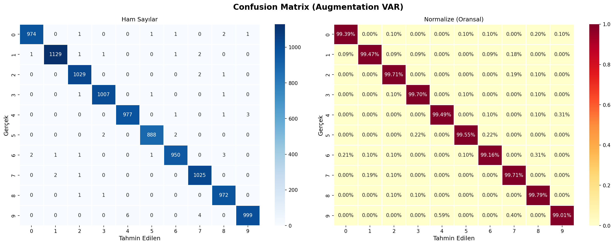
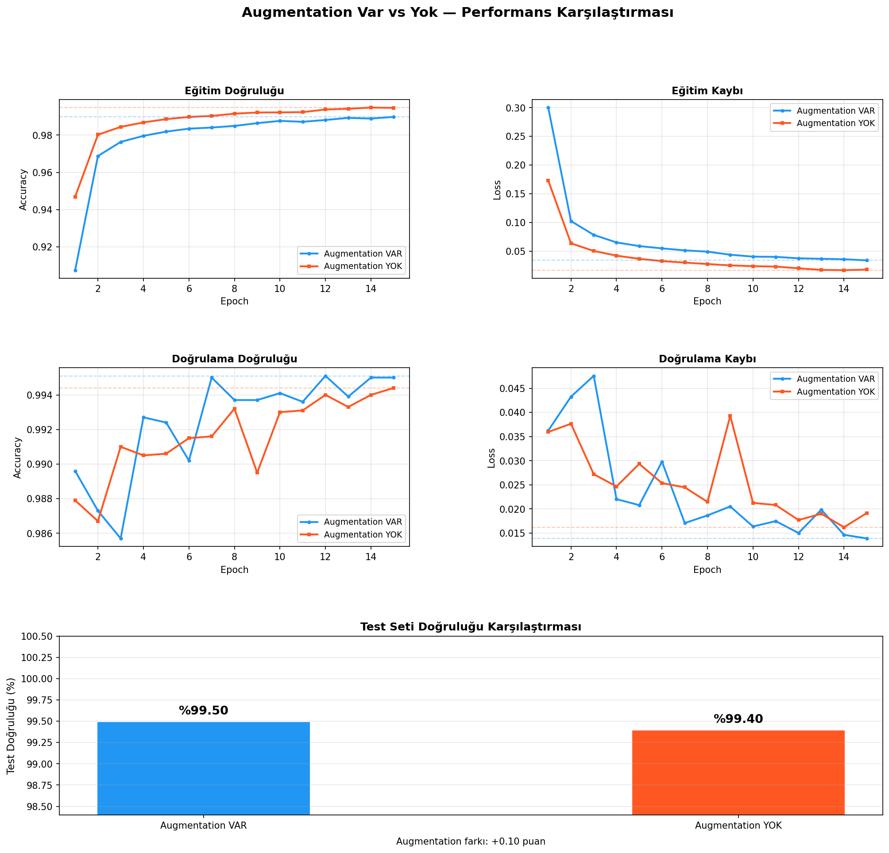

# MNIST El Yazısı Hesap Makinesi

Ekrana çizilen rakamları ve operatörleri (+, −, ×, ÷) gerçek zamanlı tanıyıp sonucu hesaplayan masaüstü uygulaması.

> Yapay Zeka ve İlkeleri dersi projesi

---

## Sonuçlar

| Model | Doğruluk |
|---|---|
| Rakam CNN (augmentation var) | ~%99.5 (MNIST) |
| Rakam CNN (augmentation yok) | ~%99.4 (MNIST) |
| Operatör CNN (sentetik veri) | ~%97 |

- En çok karışan rakam 8'di (0, 6 ve 9 ile). Sınıf ağırlıklandırmasıyla 8'e 2.5× ek ağırlık verildi.
- Doğrulama seti eğitim verisinden ayrılır (son 6.000 örnek). Test seti eğitim sırasında hiç kullanılmaz, yalnızca en sondaki değerlendirmede kullanılır.

| Confusion Matrix | Augmentation Karşılaştırması |
|---|---|
|  |  |

---

## Proje Yapısı

```
.
├── train_model.py            # Rakam modeli eğitimi (augmentation var + yok)
├── train_operator.py         # Operatör modeli eğitimi (sentetik veri)
├── app.py                    # Tkinter arayüzü
├── show_confusion_matrix.py  # Confusion matrix görüntüleyici
├── show_comparison.py        # Augmentation karşılaştırma grafiği
└── requirements.txt
```

## Kurulum ve Kullanım

```bash
pip install -r requirements.txt

python train_model.py      # mnist_model.keras + mnist_model_no_aug.keras
python train_operator.py   # operator_model.keras
python app.py              # uygulamayı başlat
```

Eğitilmiş modeller repoda hazır olarak bulunduğu için doğrudan `python app.py` ile de başlatabilirsiniz.

---

## Özellikler

| Özellik | Açıklama |
|---|---|
| Sol / sağ sayı | 1–3 basamak, ayrı çizim kutuları |
| Operatör çizimi | +, −, ×, ÷ çizilerek tanınır |
| Canlı tahmin | Fare bırakıldıktan 1 sn sonra otomatik tanıma |
| Sıralı okuma | Rakamlar soldan sağa birleşerek sayı oluşturur |
| Güven skoru | Her tahminin altında softmax olasılığı |
| Otomatik hesaplama | Üç alan da doldurulunca sonuç çıkar |

## Model Mimarisi

**Rakam modeli**
- 2× Conv blok: Conv2D → BatchNorm → Conv2D → MaxPool → Dropout(0.25)  (32 ve 64 filtre)
- Dense(256) → BatchNorm → Dropout(0.5) → Dense(10, softmax)
- Adam, categorical crossentropy (label smoothing 0.1), EarlyStopping + ReduceLROnPlateau

**Operatör modeli**
- MNIST'te operatör olmadığı için PIL ile sentetik veri üretilir (4 sınıf × 8.000 örnek)
- Küçük bir CNN, %15 doğrulama ayrımıyla eğitilir

## Veri Artırımı (Augmentation)

- Döndürme ±12°
- Yatay/dikey kaydırma %10
- Yakınlaştırma %12
- Kesme (shear) %10

## Teknolojiler

Python · TensorFlow/Keras · NumPy · scikit-learn · Matplotlib/Seaborn · Pillow · Tkinter
